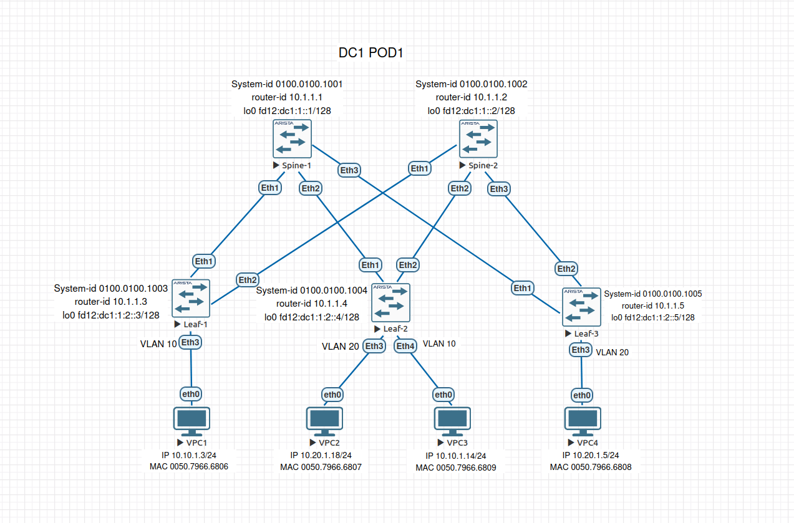
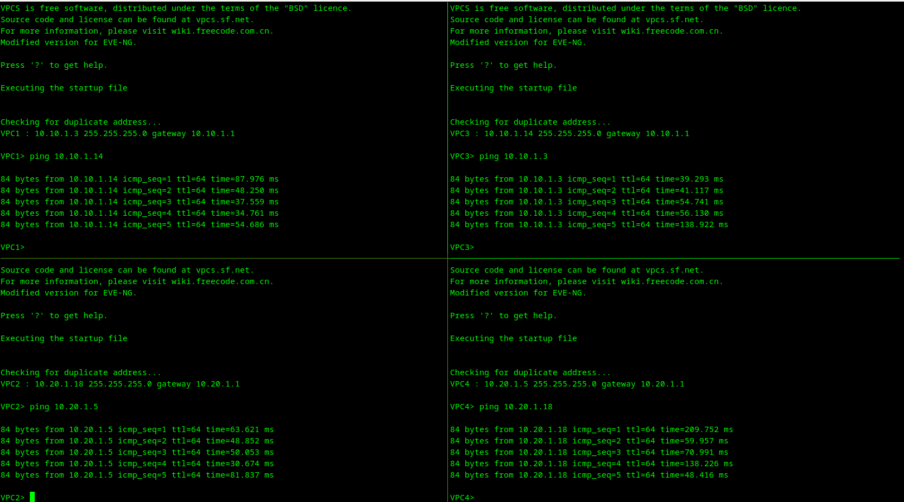
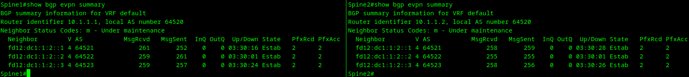
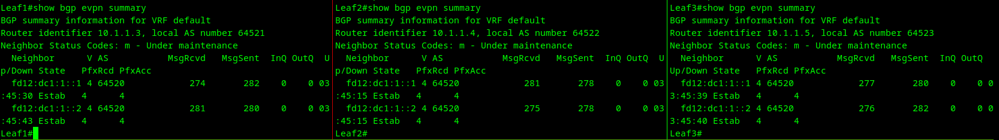
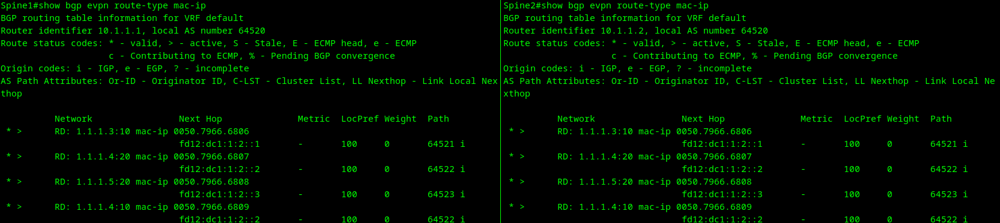
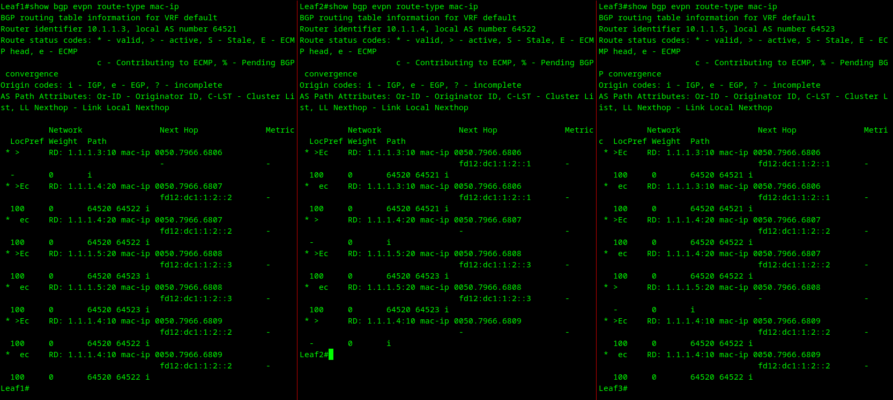
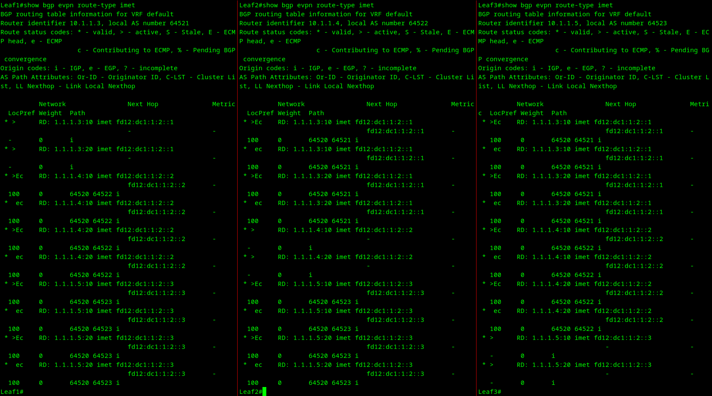
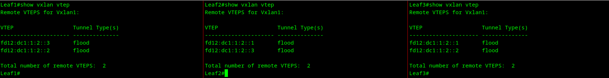
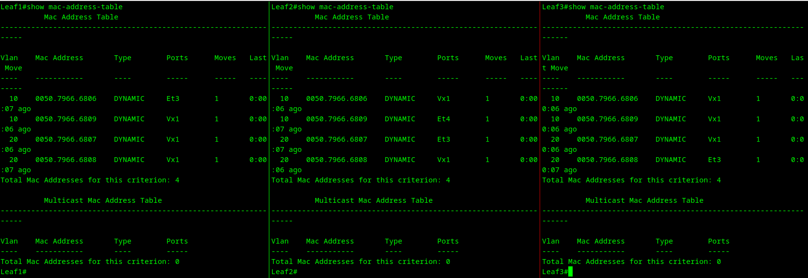

# Проектная работа

## Построение фабрики VXLAN/EVPN для двух POD с использованием технологии Multisite

### Цель:
1. В городах А и Б построить два POD, по одному в каждом, по топологии Clos на основе VxLAN EVPN для L2 связности между клиентами
2. Обеспечить сетевую связность между POD(Site) с использованием технологии Multisite

### План работ
1. Собрать схему Clos
2. Распределить адресное пространство
3. Настроить IS-IS в Underlay-сети в каждом POD
4. Настроить Overlay на основе iBGP в каждом POD
6. Настроить VXLAN в каждом POD
5. Настроить DCI между BGW
6. Проверка результатов работы

### Краткое oписание объекта
У нас есть 2 POD разнесённые в разные города (город А и город Б). Каждый POD мы будем собирать по топологии Clos.

Перед нами стоит задача обеспечить связность двух POD по сети оператора связи (ISP).

### 1. Сборка схемы Clos

Схема по топологии Clos была собрана в EVE-NG. В качестве основных элементов схемы, Spine-, Leaf-, и BGW-оммутаторов, использовались виртуальные образы Arista vEOS-lab версии 4.29.2F.
В роли клиентов выступают виртуальные эмуляторы VPC. Именно будут являться источником трафика, именно их MAC-адреса будут транслироваться соседям по фабрике.
В роли маршрутизатора ISP выступает образ Cisco vIOS версии 15.7(3)M3.


В начале работы на каждом коммутаторе активируем в EOS мультиагентную архитектуру для протоколов маршрутизации. Это необходимо для функционирования EVPN.
```
service routing protocols model multi-agent
```

### 2. Распределение адресного пространства

В качестве протокола, на котором будет строиться Underlay, был выбран IPv6. IS-IS-соседство будем строить от Link-Local адресов.

Таким образом, остаётся назначить IPv6-адреса только интерфейсам loopback 0, loopback 1 и интерфейсам BGW, которые будут состыкованными маршрутизатором ISP.

Пусть IPv6-адреса, назначаемые интерфейсам loopback 0 на Spine-коммутаторах принадлежат сети fd12:dcN:1:0::/63, а на Leaf- и BGW-коммутаторах сети fd12:dcN:1:2::/63, где N - номер POD.

Также для каждого коммутатора необходимо определить NET (Network Entity Title) - уникальный идентификатор.
NET состоит из нескольких частей:
- AFI (Authority and Format Identifier) — идентификатор класса адреса. Всегда равно 49 и говорит, что это приватный адрес.
- Area ID — идентификатор зоны, к которой принадлежит узел. В нашем случае соответствует номерам POD, принимаем равными 0001 и 0002 соответственно.
- System ID — уникальный идентификатор самого устройства (см. ниже).
- NSEL (Network Selector) — селектор сети. Всегда должен быть равно 00. 

System-id будем формировать из router-id, которые мы ранее назначим коммутаторам, когда будем строить OverLay по протоколу BGP.  
Пребразуем router-id в System-id по следующей схеме:  
- если десятичная запись значения октета router-id имеет 1 или 2 разряда, то дополняем его впереди стоящими двумя или одним 0 соответственно, чтобы число разрядов в значении октета стало равным 3;
- если десятичная запись значения октета router-id имеет 3 разряда, то оставляем его без изменений;
- преобразуем полученную запись в System-id - XXXX.XXXX.XXXX.  
Пример: 10.1.1.1 -> 010.001.001.001 -> 0100.0100.1001

Сведём полученные данные в таблицу:

Device|loopback 0|loopback 1|router-id|System-id|NET
------|----------|----------|---------|---------|---
Spine1-1|fd12:dc1:1::1/128| нет |10.1.1.1|0100.0100.1001|49.0001.0100.0100.1001.00
Spine1-2|fd12:dc1:1::2/128| нет |10.1.1.2|0100.0100.1002|49.0001.0100.0100.1002.00
Leaf1-1|fd12:dc1:1::3/128| нет |10.1.1.3|0100.0100.1003|49.0001.0100.0100.1003.00
BGW1-1|fd12:dc1:1::4/128|fd12:dc1:100::100|10.1.1.4|0100.0100.1004|49.0001.0100.0100.1004.00
BGW1-2|fd12:dc1:1::5/128|fd12:dc1:100::100|10.1.1.5|0100.0100.1005|49.0001.0100.0100.1005.00
Spine2-1|fd12:dc2:1::1/128| нет |10.2.1.1|0100.0100.1001|49.0002.0100.0100.1001.00
Spine2-2|fd12:dc2:1::2/128| нет |10.2.1.2|0100.0100.1002|49.0002.0100.0100.1002.00
Leaf2-1|fd12:dc2:1::5/128| нет |10.2.1.3|0100.0100.1005|49.0002.0100.0100.1005.00
BGW2-1|fd12:dc2:1::4/128|fd12:dc2:100::100|10.2.1.4|0100.0100.1004|49.0002.0100.0100.1004.00
BGW2-2|fd12:dc2:1::3/128|fd12:dc2:100::100|10.2.1.5|0100.0100.1003|49.0002.0100.0100.1003.00

где:  
- loopback 0 4-ый октет - Порядковый номер POD;  
- loopback 0 16-ый октет Порядковый номер устройства в POD;  
- loopback 1 4-ый октет - Порядковый номер POD;  
- router-id 2-ой октет Порядковый номер POD;  
- router-id 4-ой октет - Порядковый номер устройства в POD.  

У нас есть также виртуальные PC, играющие роль серверов. Они работают каждый в своём VLAN. Назначим каждому VPC IP-адрес, а каждому VLAN свой VNI:

Device|IP-адрес|VLAN ID|VNI
------|--------|-------|--
VPC1-1|10.10.1.3/24|10|1000010
VPC1-2|10.20.1.8/24|20|1000020
VPC2-1|10.10.1.14/24|10|1000010
VPC2-2|10.20.1.5/24|20|1000020

Примечание: Для краткости не будем приводить здесь команды назначения IPv6 адресов на интерфейсы loopback 0, loopback 1 коммутаторов. Они будут показаны в листингах конфигураций оборудования.

Распределим адресное пространство для сети DCI:

Device|Ethernet 3|Интерфейсы ISP-Router
------|----------|---------------------
BGW1-1|fd12:dc1:1:201::2/64| Gi0/0 fd12:dc1:1:201::1/64 
BGW1-2|fd12:dc1:1:202::2/64| Gi0/1 fd12:dc1:1:202::1/64 
BGW2-1|fd12:dc2:1:201::2/64| Gi0/3 fd12:dc2:1:201::1/64 
BGW2-2|fd12:dc2:1:202::2/64| Gi0/2 fd12:dc2:1:202::1/64 


### 3. Настройка IS-IS (Underlay)
На примере коммутатора Spine1-1 покажем как выполнялась конфигурация коммутаторов в POD1:

- включаем на коммутаторе маршрутизацию IPv6:
```
Spine1-1(config)ipv6 unicast-routing vrf default
```

- далее, в vrf default запускаем процесс IS-IS и указываем NET:
```
Spine1-1(config)#router isis SITE1-UNDERLAY vrf default
Spine1-1(config-router-isis)#net 49.0001.0100.0100.1001.00
Spine1-1(config-router-isis)#address-family ipv6 unicast
```

- на каждом из физических интерфейсов устанавливаем mtu 9000, включаем IPv6, указываем, что интерфейс включен в инстанс SITE1-UNDERLAY процеса IS-IS, включаем BFD, задаём тип сети point-to-point, а также уровень отношений с соседями на этом интерфейсе: L1:
```
Spine1-1(config)#interface Ethernet1-3
Spine1-1(config-if-Et1-3)#mtu 9000
Spine1-1(config-if-Et1-3)#no switchport
Spine1-1(config-if-Et1-3)#ipv6 enable
Spine1-1(config-if-Et1-3)#isis enable SITE1-UNDERLAY
Spine1-1(config-if-Et1-3)#isis ipv6 bfd
Spine1-1(config-if-Et1-3)#isis circuit-type level-1
Spine1-1(config-if-Et1-3)#isis network point-to-point
```
- настраиваем аутентификацию, как дополнительный функционал протокола IS-IS.
    - вначале включаем аутентификации на интерфейсах. Это обеспечит аутентификацию только HELLO-пакетов.
    ```
   Spine1-1(config)#interface Ethernet1
   Spine1-1(config-if-Et1-3)#isis authentication mode sha key-id 33333
   Spine1-1(config-if-Et1-3)#isis authentication key-id 33333 algorithm sha-256 key 7 fQ2hST20Ozo7y2Zpdxveag==
   ```
   - теперь включаем аунтентификацию на уровне процесса. Это защитит LSDB от несанкционированной записи маршрутов:
   ```
   Spine1-1(config)#router isis SITE1-UNDERLAY
   Spine1-1(config-if-Et1-3)#authentication mode sha key-id 33333
   Spine1-1(config-if-Et1-3)#authentication key-id 33333 algorithm sha-256 key 7 fQ2hST20Ozo7y2Zpdxveag==
   ```
   - проверяем работу аутентификации на примере IS-IS соседства коммутаторов Spine1-1 и Leaf1-1, убедившись, что соседство между ними установлено и маршруты мы получаем: 
       ```
       Leaf1-1#show isis neighbors

       Instance  VRF      System Id        Type Interface          SNPA              State Hold time   Circuit Id
       SITE1-UNDERLAY  default  Spine1-1           L1   Ethernet1          P2P               UP    26          0B
       SITE1-UNDERLAY  default  Spine1-2           L1   Ethernet2          P2P               UP    30          0D

       Leaf1-1#show ipv6 route isis
       
       VRF: default
       Displaying 4 of 8 IPv6 routing table entries
       Codes: C - connected, S - static, K - kernel, O3 - OSPFv3,
              B - Other BGP Routes, A B - BGP Aggregate, R - RIP,
              I L1 - IS-IS level 1, I L2 - IS-IS level 2, DH - DHCP,
              NG - Nexthop Group Static Route, M - Martian,
              DP - Dynamic Policy Route, L - VRF Leaked,
              RC - Route Cache Route
       
         I L1     fd12:dc1:1::1/128 [115/20]
                   via fe80::5200:ff:fed7:ee0b, Ethernet1
         I L1     fd12:dc1:1::2/128 [115/20]
                   via fe80::5200:ff:fecb:38c2, Ethernet2
         I L1     fd12:dc1:1::4/128 [115/30]
                   via fe80::5200:ff:fed7:ee0b, Ethernet1
                   via fe80::5200:ff:fecb:38c2, Ethernet2
         I L1     fd12:dc1:1::5/128 [115/30]
                   via fe80::5200:ff:fed7:ee0b, Ethernet1
                   via fe80::5200:ff:fecb:38c2, Ethernet2
         I L1     fd12:dc1:100::100/128 [115/30]
                   via fe80::5200:ff:fed7:ee0b, Ethernet1
                   via fe80::5200:ff:fecb:38c2, Ethernet2
       ```
Выполняем аналогичные действия в POD2 согласно разработанному адресному плану. По окончании убеждаемся, что все устройства установили соседство по протоколу isis и обмениваются маршрутами.

### 4. Настройка EBGP (Overlay)

Процедуры настройки EBGP на Spine-, Leaf-, BGW-коммутаторах будут отличаться друг от друга.  
Вначале oпишем процедуру настройки на Spine-коммутаторе:
- создаём на Spine-коммутаторах процесс BGP 64521, при этом указываем какую сеть IPv6 (Loopback 0) слушать, чтобы установить соседство с указанными в peer-filter номерами AS:
```
router bgp 64521
   router-id 10.1.1.1
   no bgp default ipv4-unicast
   distance bgp 20 200 200
   maximum-paths 2 ecmp 2
   bgp listen range fd12:dc1:1::/64 peer-group SITE1-LEAVES remote-as 64521
   neighbor SITE1-LEAVES peer group
   neighbor SITE1-LEAVES update-source Loopback0
   neighbor SITE1-LEAVES route-reflector-client
   neighbor SITE1-LEAVES send-community extended
   neighbor SITE1-LEAVES maximum-routes 0
   !
   address-family evpn
      neighbor SITE1-LEAVES activate
   !
   address-family ipv4
      neighbor SITE1-LEAVES activate
   !
   address-family ipv6
      neighbor SITE1-LEAVES activate
```
Незабываем указать, что наши Spine будут являться клиентами и отражать маршруты.

На Leaf- и BGW-коммутаторах мы должны будем указать IPv6 адреса, прописанные на Loopback 0 Spine-коммутаторов (пример для Leaf1):
```
router bgp 64521
   router-id 10.1.1.3
   no bgp default ipv4-unicast
   distance bgp 20 200 200
   maximum-paths 2 ecmp 2
   neighbor SITE1-SPINES peer group
   neighbor SITE1-SPINES remote-as 64521
   neighbor SITE1-SPINES update-source Loopback0
   neighbor SITE1-SPINES send-community extended
   neighbor fd12:dc1:1::1 peer group SITE1-SPINES
   neighbor fd12:dc1:1::2 peer group SITE1-SPINES
   !
   address-family evpn
      neighbor SITE1-SPINES activate
   !
   address-family ipv4
      neighbor SITE1-SPINES activate
   !
   address-family ipv6
      neighbor SITE1-SPINES activate
```
Смотрим что у нас получилось:
- Spine1:
```
Spine1-1(config)#show bgp summary
BGP summary information for VRF default
Router identifier 10.1.1.1, local AS number 64521
Neighbor               AS Session State AFI/SAFI                AFI/SAFI State   NLRI Rcd   NLRI Acc
------------- ----------- ------------- ----------------------- -------------- ---------- ----------
fd12:dc1:1::3       64521 Established   L2VPN EVPN              Negotiated              4          4
fd12:dc1:1::4       64521 Established   L2VPN EVPN              Negotiated              2          2
fd12:dc1:1::5       64521 Established   L2VPN EVPN              Negotiated              2          2
```
- Leaf1:
```
BGP summary information for VRF default
Router identifier 10.1.1.3, local AS number 64521
Neighbor               AS Session State AFI/SAFI                AFI/SAFI State   NLRI Rcd   NLRI Acc
------------- ----------- ------------- ----------------------- -------------- ---------- ----------
fd12:dc1:1::1       64521 Established   L2VPN EVPN              Negotiated              4          4
fd12:dc1:1::2       64521 Established   L2VPN EVPN              Negotiated              4          4
```
Итак, BGP-соседство установлено, переходим к следующему этапу, а именно к построению EVPN.

### 5. Настройка VXLAN

#### На Leaf-коммутаторе
Создаём интерфейсы VXLAN и каждому VLAN сопостовляем его VNI:
```
Leaf1-1#show running-config interface vxlan1
interface Vxlan1
   vxlan source-interface Loopback0
   vxlan udp-port 4789
   vxlan encapsulation ipv6
   vxlan vlan 10 vni 1000010
   vxlan vlan 20 vni 1000020
   vxlan vrf VRF2026 vni 1111111
   vxlan learn-restrict any
```
А в настройках процесса BGP указываем, что нужно дистрибьютить и включаем работу EVPN:
```
router bgp 64521
   vlan 10
      rd auto
      route-target both 10:1000010
      redistribute learned
   !
   vlan 20
      rd auto
      route-target both 20:1000020
      redistribute learned
   !
   address-family evpn
      neighbor SITE1-SPINES activate
   !
```
#### На BGW-коммутаторах
Дело будет обстоять несколько иначе. Во-первых VXLAN здесь будет строиться от интерфейса loopback 1, а во-вторых мы зафиксируем MAC‑адрес, который устройство будет использовать как «виртуальный роутер» для VXLAN:
```
interface Vxlan1
   vxlan source-interface Loopback1
   vxlan virtual-router encapsulation mac-address 00:00:01:0a:fe:01
   vxlan udp-port 4789
   vxlan encapsulation ipv6
   vxlan vlan 10 vni 1000010
   vxlan vlan 20 vni 1000020
   vxlan vrf VRF2026 vni 1111111
   vxlan learn-restrict any
```
В настройках процесса BGP указываем, что нужно дистрибьютить и включаем работу EVPN:
```
router bgp 64521
   vlan 10
      rd evpn domain all 10.1.1.4:10
      route-target both 10:1000010
      route-target import export evpn domain remote 10:10
      redistribute learned
   !
   vlan 20
      rd evpn domain all 10.1.1.4:20
      route-target both 20:1000020
      route-target import export evpn domain remote 20:20
      redistribute learned
   !
   address-family evpn
      neighbor SITE1-SPINES activate
```
#### На Spine-коммутаторах
Делать ничего не нужно, там достаточно включить EVPN:
```
router bgp 64521
 address-family evpn
    neighbor SITE1-LEAVES activate
```

### 5. Настройка DCI между BGW

#### Подготовка роутера ISP

Мы будем использовать статическую маршрутизацию, поэтому на роутере ISP достаточно будет прописать  ipv6-адреса на интерфейсах для стыковки с BGW и прописать маршруты в таблицу маршрутизации:

```
interface GigabitEthernet0/3
 mtu 9200
 no ip address
 duplex auto
 speed 1000
 media-type rj45
 ipv6 address FD12:DC2:1:201::1/64
 ipv6 enable

ipv6 route FD12:DC1:100::100/128 FD12:DC1:1:201::2
ipv6 route FD12:DC1:100::100/128 FD12:DC1:1:202::2
ipv6 route FD12:DC2:100::100/128 FD12:DC2:1:201::2
ipv6 route FD12:DC2:100::100/128 FD12:DC2:1:202::2
```
Важный момент: на интерфейсах мы установили MTU 9200, это необходимо, чтобы большие пакеты с VXLAN-инкапсуляцией свободно курсировали между PODами.

#### Построение BGP-соседства между POD

Для начало в настройках процесса BGP каждого BGW-коммутатора создадим peer-group DCI, укажем ASN того POD, с кем выстраиваем соседство, и укажем ipv6-адреса соседей.
```
router bgp 64521
   router-id 10.1.1.4
   no bgp default ipv4-unicast
   distance bgp 20 200 200
   maximum-paths 2 ecmp 2
   neighbor DCI peer group
   neighbor DCI remote-as 64522
   neighbor DCI ebgp-multihop 2
   neighbor DCI send-community extended
   neighbor fd12:dc2:1:201::2 peer group DCI
   neighbor fd12:dc2:1:202::2 peer group DCI
```
А теперь включаем эту группу в адресном семействе evpn, указываем то, что это будет удалённый домен и чтобы наш BGW при анонсе маршрутов во внутреннюю сеть указывал себя в качестве next-hop.
```
   address-family evpn
      neighbor DCI activate
      neighbor DCI domain remote
      neighbor SITE1-SPINES activate
      neighbor default next-hop-self received-evpn-routes route-type ip-prefix inter-domain
```

### Проверка результатов работы

- Убедимся, что каждый виртуальный PC видит своего соседа в том же VLAN:



Ок! Значит связность есть.

- Далее смотрим установилось ли у нас BGP-EVPN-соседство между Spine- и Leaf-коммутаторами. Об этом нам скажет статус Up в колонке State в строке с указанием  System-id IS-IS-соседа:


  
    
- Далее смотрим маршруты типа 2 и 3 на Spine-коммутаторах:




- Cмотрим маршруты типа 2 и 3 на Leaf-коммутаторах:




- Смотрим удалённые VTEP и типы тоннелей до них:



- Таблицы MAC-адрессов каждого Leaf:



Выводы:
1. Настроен BGP peering между Leaf и Spine в AF l2vpn evpn.
2. Связанность между клиентами обеспечена.

#### Листинги

[Spine1.cfg](./Spine1.cfg)  
[Spine2.cfg](./Spine2.cfg)  
[Leaf1.cfg](./Leaf1.cfg)  
[Leaf2.cfg](./Leaf2.cfg)  
[Leaf3.cfg](./Leaf3.cfg)
