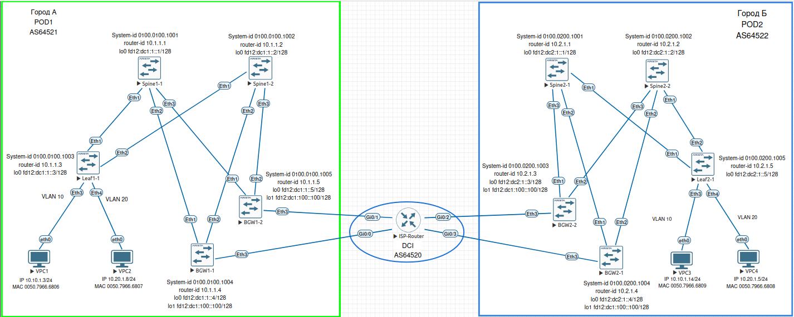
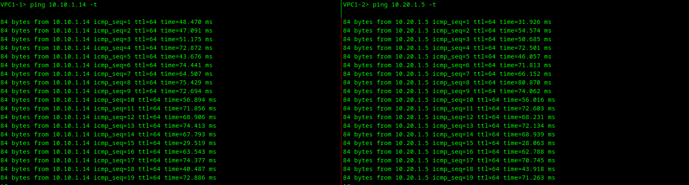
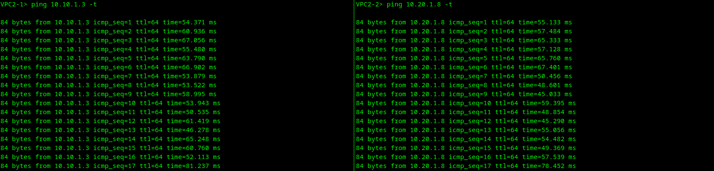

# Проектная работа

## Построение фабрики VXLAN/EVPN для двух POD с использованием технологии Multisite

### Цель:
1. В городах А и Б построить два POD, по одному в каждом, по топологии Clos на основе VxLAN EVPN для L2 связности между клиентами
2. Обеспечить сетевую связность между POD с использованием технологии Multisite

### План работ
1. Собрать схему Clos
2. Распределить адресное пространство
3. Настроить IS-IS в Underlay-сети в каждом POD
4. Настроить Overlay на основе iBGP в каждом POD
5. Настроить VXLAN в каждом POD
6. Настроить DCI между BGW
7. Проверка результатов работы

### Краткое oписание объекта
У нас есть 2 POD разнесённые в разные города (город А и город Б). Каждый POD мы будем собирать по топологии Clos.

Перед нами стоит задача обеспечить связность двух POD по сети оператора связи (ISP).

### 1. Сборка схемы Clos

Схема по топологии Clos была собрана в EVE-NG. В качестве основных элементов схемы, Spine-, Leaf-, и BGW-оммутаторов, использовались виртуальные образы Arista vEOS-lab версии 4.29.2F.
В роли клиентов выступают виртуальные эмуляторы VPC. Именно будут являться источником трафика, именно их MAC-адреса будут транслироваться соседям по фабрике.
В роли маршрутизатора ISP выступает образ Cisco vIOS версии 15.7(3)M3.


В начале работы на каждом коммутаторе активируем в EOS мультиагентную архитектуру для протоколов маршрутизации. Это необходимо для функционирования EVPN.
```
service routing protocols model multi-agent
```

### 2. Распределение адресного пространства

В качестве протокола, на котором будет строиться Underlay, был выбран IPv6. IS-IS-соседство будем строить от Link-Local адресов.

Таким образом, остаётся назначить IPv6-адреса только интерфейсам loopback 0, loopback 1 и интерфейсам BGW, которые будут состыкованными маршрутизатором ISP.

Пусть IPv6-адреса, назначаемые интерфейсам loopback 0 на Spine-коммутаторах принадлежат сети fd12:dcN:1:0::/63, а на Leaf- и BGW-коммутаторах сети fd12:dcN:1:2::/63, где N - номер POD.

Также для каждого коммутатора необходимо определить NET (Network Entity Title) - уникальный идентификатор.
NET состоит из нескольких частей:
- AFI (Authority and Format Identifier) — идентификатор класса адреса. Всегда равно 49 и говорит, что это приватный адрес.
- Area ID — идентификатор зоны, к которой принадлежит узел. В нашем случае соответствует номерам POD, принимаем равными 0001 и 0002 соответственно.
- System ID — уникальный идентификатор самого устройства (см. ниже).
- NSEL (Network Selector) — селектор сети. Всегда должен быть равно 00. 

System-id будем формировать из router-id, которые мы ранее назначим коммутаторам, когда будем строить OverLay по протоколу BGP.  
Пребразуем router-id в System-id по следующей схеме:  
- если десятичная запись значения октета router-id имеет 1 или 2 разряда, то дополняем его впереди стоящими двумя или одним 0 соответственно, чтобы число разрядов в значении октета стало равным 3;
- если десятичная запись значения октета router-id имеет 3 разряда, то оставляем его без изменений;
- преобразуем полученную запись в System-id - XXXX.XXXX.XXXX.  
Пример: 10.1.1.1 -> 010.001.001.001 -> 0100.0100.1001

Сведём полученные данные в таблицу:

Device|loopback 0|loopback 1|router-id|System-id|NET
------|----------|----------|---------|---------|---
Spine1-1|fd12:dc1:1::1/128| нет |10.1.1.1|0100.0100.1001|49.0001.0100.0100.1001.00
Spine1-2|fd12:dc1:1::2/128| нет |10.1.1.2|0100.0100.1002|49.0001.0100.0100.1002.00
Leaf1-1|fd12:dc1:1::3/128| нет |10.1.1.3|0100.0100.1003|49.0001.0100.0100.1003.00
BGW1-1|fd12:dc1:1::4/128|fd12:dc1:100::100|10.1.1.4|0100.0100.1004|49.0001.0100.0100.1004.00
BGW1-2|fd12:dc1:1::5/128|fd12:dc1:100::100|10.1.1.5|0100.0100.1005|49.0001.0100.0100.1005.00
Spine2-1|fd12:dc2:1::1/128| нет |10.2.1.1|0100.0200.1001|49.0002.0100.0200.1001.00
Spine2-2|fd12:dc2:1::2/128| нет |10.2.1.2|0100.0200.1002|49.0002.0100.0200.1002.00
Leaf2-1|fd12:dc2:1::5/128| нет |10.2.1.3|0100.0200.1005|49.0002.0100.0200.1005.00
BGW2-1|fd12:dc2:1::4/128|fd12:dc2:100::100|10.2.1.4|0100.0200.1004|49.0002.0100.0200.1004.00
BGW2-2|fd12:dc2:1::3/128|fd12:dc2:100::100|10.2.1.5|0100.0200.1003|49.0002.0100.0200.1003.00

где:  
- loopback 0 4-ый октет - Порядковый номер POD;  
- loopback 0 16-ый октет Порядковый номер устройства в POD;  
- loopback 1 4-ый октет - Порядковый номер POD;  
- router-id 2-ой октет Порядковый номер POD;  
- router-id 4-ой октет - Порядковый номер устройства в POD.  

У нас есть также виртуальные PC, играющие роль серверов. Они работают каждый в своём VLAN. Назначим каждому VPC IP-адрес, а каждому VLAN свой VNI:

Device|IP-адрес|VLAN ID|VNI
------|--------|-------|--
VPC1-1|10.10.1.3/24|10|1000010
VPC1-2|10.20.1.8/24|20|1000020
VPC2-1|10.10.1.14/24|10|1000010
VPC2-2|10.20.1.5/24|20|1000020

Примечание: Для краткости не будем приводить здесь команды назначения IPv6 адресов на интерфейсы loopback 0, loopback 1 коммутаторов. Они будут показаны в листингах конфигураций оборудования.

Распределим адресное пространство для сети DCI:

Device|Ethernet 3|Интерфейсы ISP-Router
------|----------|---------------------
BGW1-1|fd12:dc1:1:201::2/64| Gi0/0 fd12:dc1:1:201::1/64 
BGW1-2|fd12:dc1:1:202::2/64| Gi0/1 fd12:dc1:1:202::1/64 
BGW2-1|fd12:dc2:1:201::2/64| Gi0/3 fd12:dc2:1:201::1/64 
BGW2-2|fd12:dc2:1:202::2/64| Gi0/2 fd12:dc2:1:202::1/64 


### 3. Настройка IS-IS (Underlay)
На примере коммутатора Spine1-1 покажем как выполнялась конфигурация коммутаторов в POD1:

- включаем на коммутаторе маршрутизацию IPv6:
```
Spine1-1(config)ipv6 unicast-routing vrf default
```

- далее, в vrf default запускаем процесс IS-IS и указываем NET:
```
Spine1-1(config)#router isis SITE1-UNDERLAY vrf default
Spine1-1(config-router-isis)#net 49.0001.0100.0100.1001.00
Spine1-1(config-router-isis)#address-family ipv6 unicast
```

- на каждом из физических интерфейсов устанавливаем mtu 9000, включаем IPv6, указываем, что интерфейс включен в инстанс SITE1-UNDERLAY процеса IS-IS, включаем BFD, задаём тип сети point-to-point, а также уровень отношений с соседями на этом интерфейсе: L1:
```
Spine1-1(config)#interface Ethernet1-3
Spine1-1(config-if-Et1-3)#mtu 9000
Spine1-1(config-if-Et1-3)#no switchport
Spine1-1(config-if-Et1-3)#ipv6 enable
Spine1-1(config-if-Et1-3)#isis enable SITE1-UNDERLAY
Spine1-1(config-if-Et1-3)#isis ipv6 bfd
Spine1-1(config-if-Et1-3)#isis circuit-type level-1
Spine1-1(config-if-Et1-3)#isis network point-to-point
```
- настраиваем аутентификацию, как дополнительный функционал протокола IS-IS.
    - вначале включаем аутентификации на интерфейсах. Это обеспечит аутентификацию только HELLO-пакетов.
    ```
   Spine1-1(config)#interface Ethernet1
   Spine1-1(config-if-Et1-3)#isis authentication mode sha key-id 33333
   Spine1-1(config-if-Et1-3)#isis authentication key-id 33333 algorithm sha-256 key 7 fQ2hST20Ozo7y2Zpdxveag==
   ```
   - теперь включаем аунтентификацию на уровне процесса. Это защитит LSDB от несанкционированной записи маршрутов:
   ```
   Spine1-1(config)#router isis SITE1-UNDERLAY
   Spine1-1(config-if-Et1-3)#authentication mode sha key-id 33333
   Spine1-1(config-if-Et1-3)#authentication key-id 33333 algorithm sha-256 key 7 fQ2hST20Ozo7y2Zpdxveag==
   ```
   - проверяем работу аутентификации на примере IS-IS соседства коммутаторов Spine1-1 и Leaf1-1, убедившись, что соседство между ними установлено и маршруты мы получаем: 
       ```
       Leaf1-1#show isis neighbors

       Instance  VRF      System Id        Type Interface          SNPA              State Hold time   Circuit Id
       SITE1-UNDERLAY  default  Spine1-1           L1   Ethernet1          P2P               UP    26          0B
       SITE1-UNDERLAY  default  Spine1-2           L1   Ethernet2          P2P               UP    30          0D

       Leaf1-1#show ipv6 route isis
       
       VRF: default
       Displaying 4 of 8 IPv6 routing table entries
       Codes: C - connected, S - static, K - kernel, O3 - OSPFv3,
              B - Other BGP Routes, A B - BGP Aggregate, R - RIP,
              I L1 - IS-IS level 1, I L2 - IS-IS level 2, DH - DHCP,
              NG - Nexthop Group Static Route, M - Martian,
              DP - Dynamic Policy Route, L - VRF Leaked,
              RC - Route Cache Route
       
         I L1     fd12:dc1:1::1/128 [115/20]
                   via fe80::5200:ff:fed7:ee0b, Ethernet1
         I L1     fd12:dc1:1::2/128 [115/20]
                   via fe80::5200:ff:fecb:38c2, Ethernet2
         I L1     fd12:dc1:1::4/128 [115/30]
                   via fe80::5200:ff:fed7:ee0b, Ethernet1
                   via fe80::5200:ff:fecb:38c2, Ethernet2
         I L1     fd12:dc1:1::5/128 [115/30]
                   via fe80::5200:ff:fed7:ee0b, Ethernet1
                   via fe80::5200:ff:fecb:38c2, Ethernet2
         I L1     fd12:dc1:100::100/128 [115/30]
                   via fe80::5200:ff:fed7:ee0b, Ethernet1
                   via fe80::5200:ff:fecb:38c2, Ethernet2
       ```
Выполняем аналогичные действия в POD2 согласно разработанному адресному плану. По окончании убеждаемся, что все устройства установили соседство по протоколу isis и обмениваются маршрутами.

### 4. Настройка iBGP (Overlay)

Процедура настройки IBGP на Spine- будет несколько отличаться от аналогичной процедуры на Leaf- и BGW-коммутаторах.  
Вначале oпишем процедуру настройки на Spine-коммутаторе:
- создаём на Spine-коммутаторах процесс BGP 64521, при этом указываем какую сеть IPv6 (Loopback 0) слушать, чтобы установить соседство с указанными в peer-filter номерами AS:
```
router bgp 64521
   router-id 10.1.1.1
   no bgp default ipv4-unicast
   distance bgp 20 200 200
   maximum-paths 2 ecmp 2
   bgp listen range fd12:dc1:1::/64 peer-group SITE1-LEAVES remote-as 64521
   neighbor SITE1-LEAVES peer group
   neighbor SITE1-LEAVES update-source Loopback0
   neighbor SITE1-LEAVES route-reflector-client
   neighbor SITE1-LEAVES send-community extended
   neighbor SITE1-LEAVES maximum-routes 0
   !
   address-family evpn
      neighbor SITE1-LEAVES activate
   !
   address-family ipv4
      no neighbor SITE1-LEAVES activate
   !
   address-family ipv6
      no neighbor SITE1-LEAVES activate
```
Незабываем указать, что наши Spine будут являться клиентами и отражать маршруты.

На Leaf- и BGW-коммутаторах мы должны будем указать IPv6 адреса, прописанные на Loopback 0 Spine-коммутаторов (пример для Leaf1):
```
router bgp 64521
   router-id 10.1.1.3
   no bgp default ipv4-unicast
   distance bgp 20 200 200
   maximum-paths 2 ecmp 2
   neighbor SITE1-SPINES peer group
   neighbor SITE1-SPINES remote-as 64521
   neighbor fd12:dc1:1::1 peer group SITE1-SPINES
   neighbor fd12:dc1:1::2 peer group SITE1-SPINES
   !
   address-family evpn
      neighbor SITE1-SPINES activate
   !
   address-family ipv4
      no neighbor SITE1-SPINES activate
   !
   address-family ipv6
      no neighbor SITE1-SPINES activate
   !
```
Смотрим что у нас получилось:
- Spine1-1:
```
Spine1-1(config)#show bgp summary
BGP summary information for VRF default
Router identifier 10.1.1.1, local AS number 64521
Neighbor               AS Session State AFI/SAFI                AFI/SAFI State   NLRI Rcd   NLRI Acc
------------- ----------- ------------- ----------------------- -------------- ---------- ----------
fd12:dc1:1::3       64521 Established   L2VPN EVPN              Negotiated              4          4
fd12:dc1:1::4       64521 Established   L2VPN EVPN              Negotiated              2          2
fd12:dc1:1::5       64521 Established   L2VPN EVPN              Negotiated              2          2
```
- Leaf1-1, BGW1-1, BGW1-2:
```
BGP summary information for VRF default
Router identifier 10.1.1.3, local AS number 64521
Neighbor               AS Session State AFI/SAFI                AFI/SAFI State   NLRI Rcd   NLRI Acc
------------- ----------- ------------- ----------------------- -------------- ---------- ----------
fd12:dc1:1::1       64521 Established   L2VPN EVPN              Negotiated              4          4
fd12:dc1:1::2       64521 Established   L2VPN EVPN              Negotiated              4          4
```
Итак, BGP-соседство установлено, Overlay в рамках каждого из POD построен, переходим к следующему этапу, а именно к созданию интерфейса VXLAN.

### 5. Настройка VXLAN

#### На Leaf-коммутаторе
Создаём интерфейсы VXLAN и каждому VLAN сопостaвляем его VNI:
```
Leaf1-1#show running-config interface vxlan1
interface Vxlan1
   vxlan source-interface Loopback0
   vxlan udp-port 4789
   vxlan encapsulation ipv6
   vxlan vlan 10 vni 1000010
   vxlan vlan 20 vni 1000020
   vxlan vrf VRF2026 vni 1111111
   vxlan learn-restrict any
```
А в настройках процесса BGP указываем, что нужно дистрибьютить:
```
router bgp 64521
   neighbor SITE1-SPINES update-source Loopback0
   neighbor SITE1-SPINES send-community extended
   !
   vlan 10
      rd auto
      route-target both 10:1000010
      redistribute learned
   !
   vlan 20
      rd auto
      route-target both 20:1000020
      redistribute learned
   !
   vrf VRF2026
      rd 64521:3
      route-target import evpn 1:1111111
      route-target export evpn 1:1111111
      redistribute connected
```
#### На BGW-коммутаторах
Дело будет обстоять несколько иначе. Во-первых VXLAN здесь будет строиться от интерфейса loopback 1, а во-вторых мы зафиксируем MAC‑адрес, который устройство будет использовать как «виртуальный роутер» для VXLAN:
```
interface Vxlan1
   vxlan source-interface Loopback1
   vxlan virtual-router encapsulation mac-address 00:00:01:0a:fe:01
   vxlan udp-port 4789
   vxlan encapsulation ipv6
   vxlan vlan 10 vni 1000010
   vxlan vlan 20 vni 1000020
   vxlan vrf VRF2026 vni 1111111
   vxlan learn-restrict any
```
В настройках процесса BGP указываем, что нужно дистрибьютить:
```
router bgp 64521
   vlan 10
      rd evpn domain all 10.1.1.4:10
      route-target both 10:1000010
      route-target import export evpn domain remote 10:10
      redistribute learned
   !
   vlan 20
      rd evpn domain all 10.1.1.4:20
      route-target both 20:1000020
      route-target import export evpn domain remote 20:20
      redistribute learned
   !
   vrf VFR2026
      rd 64521:4
      route-target import evpn 1:1111111
      route-target export evpn 1:1111111
      redistribute connected
```

### 6. Настройка DCI между BGW

#### Подготовка роутера ISP

Мы будем использовать динамическую маршрутизацию. На роутере ISP настроим соседство со всеми BGW обоих POD. Чтобы маршруты быстро добавлялись в таблицу маршрутизации или удалялись из неё задействуем протокол BFD:

```
interface GigabitEthernet0/0
 mtu 9000
 no ip address
 duplex auto
 speed 1000
 media-type rj45
 ipv6 address FD12:DC1:1:201::1/64
 ipv6 enable
 bfd interval 1000 min_rx 300 multiplier 3
 no bfd echo
```
Настраиваем BGP AS64520:
```
router bgp 64520
 bgp router-id 10.0.0.1
 bgp log-neighbor-changes
 no bgp default ipv4-unicast
 neighbor BGW peer-group
 neighbor BGW fall-over bfd
 neighbor FD12:DC1:1:201::2 remote-as 64521
 neighbor FD12:DC1:1:201::2 peer-group BGW
 neighbor FD12:DC1:1:202::2 remote-as 64521
 neighbor FD12:DC1:1:202::2 peer-group BGW
 neighbor FD12:DC2:1:201::2 remote-as 64522
 neighbor FD12:DC2:1:201::2 peer-group BGW
 neighbor FD12:DC2:1:202::2 remote-as 64522
 neighbor FD12:DC2:1:202::2 peer-group BGW
 !
 address-family ipv6
  maximum-paths 2
  neighbor FD12:DC1:1:201::2 activate
  neighbor FD12:DC1:1:202::2 activate
  neighbor FD12:DC2:1:201::2 activate
  neighbor FD12:DC2:1:202::2 activate
 exit-address-family
```
Важный момент: на интерфейсах мы установили MTU 9000, это необходимо, чтобы большие пакеты с VXLAN-инкапсуляцией свободно курсировали между PODами.

#### Построение BGP-соседства между POD

Для начала в настройках процесса BGP каждого BGW-коммутатора создадим новую peer-group DCI, укажем ASN роутера ISP и укажем ipv6-адрес его интерфейса. Также необходимо отключить эту группу в адресных семействах, в которых она не будет функционировать, а именно: evpn и ipv4. Но в адресном семействе ipv6 мы его включаем и указываем, что в сторону ISP-роутера должны анонсироваться IP-адреса интерфейсов loopback 0 и 1:
```
router bgp 64521
   neighbor DCI peer group
   neighbor DCI remote-as 64520
   neighbor DCI bfd
   neighbor fd12:dc1:1:201::1 peer group DCI
   !
   address-family evpn
      no neighbor DCI activate
   !
   address-family ipv4
      no neighbor DCI activate
   !
   address-family ipv6
      neighbor DCI activate
      network fd12:dc1:1::4/128
      network fd12:dc1:100::100/128
```
То, что мы только, что настроили, есть не что иное, как UNDERLAY в сети DCI.

А теперь переходим к самому интересному: настраиваем Overlay, то есть EVPN, между BGW-коммутаторами обоих POD. Создадим ещё одну новую группу, и в её составе указываем IPv6-адреса интерфейсов loopback 0 BGW-коммутаторов из другого POD. В адресном семействе evpn, указываем то, что это будет удалённый домен и чтобы наш BGW при анонсе маршрутов во внутреннюю сеть указывал себя в качестве next-hop.
```
router bgp 64521
   neighbor SITE2-BGWS peer group
   neighbor SITE2-BGWS remote-as 64522
   neighbor SITE2-BGWS update-source Loopback0
   neighbor SITE2-BGWS ebgp-multihop 10
   neighbor SITE2-BGWS send-community extended
   neighbor fd12:dc2:1::3 peer group SITE2-BGWS
   neighbor fd12:dc2:1::4 peer group SITE2-BGWS
   !
   address-family evpn
      neighbor SITE2-BGWS activate
      neighbor SITE2-BGWS domain remote
      neighbor default next-hop-self received-evpn-routes route-type ip-prefix inter-domain
   !
   address-family ipv4
      no neighbor SITE2-BGWS activate
   !
   address-family ipv6
      no neighbor SITE2-BGWS activate
```

### 8. Проверка результатов работы

- Смотрим установилось ли у нас BGP-EVPN-соседство между BGW-коммутаторами обоих POD. Мы должны увидеть соседей из других автономных систем.
    - для POD1:
```
BGW1-1#show bgp summary
BGP summary information for VRF default
Router identifier 10.1.1.4, local AS number 64521
Neighbor                   AS Session State AFI/SAFI                AFI/SAFI State   NLRI Rcd   NLRI Acc
----------------- ----------- ------------- ----------------------- -------------- ---------- ----------
fd12:dc1:1::1           64521 Established   L2VPN EVPN              Negotiated             11         11
fd12:dc1:1::2           64521 Established   L2VPN EVPN              Negotiated             11         11
fd12:dc1:1:201::1       64520 Established   IPv6 Unicast            Negotiated              3          3
fd12:dc2:1::3           64522 Established   L2VPN EVPN              Negotiated              5          5
fd12:dc2:1::4           64522 Established   L2VPN EVPN              Negotiated              5          5

BGW1-2#show bgp summary
BGP summary information for VRF default
Router identifier 10.1.1.5, local AS number 64521
Neighbor                   AS Session State AFI/SAFI                AFI/SAFI State   NLRI Rcd   NLRI Acc
----------------- ----------- ------------- ----------------------- -------------- ---------- ----------
fd12:dc1:1::1           64521 Established   L2VPN EVPN              Negotiated             11         11
fd12:dc1:1::2           64521 Established   L2VPN EVPN              Negotiated             11         11
fd12:dc1:1:202::1       64520 Established   IPv6 Unicast            Negotiated              3          3
fd12:dc2:1::3           64522 Established   L2VPN EVPN              Negotiated              5          5
fd12:dc2:1::4           64522 Established   L2VPN EVPN              Negotiated              5          5
```
    - для POD2:
```
BGW2-1#show bgp summary
BGP summary information for VRF default
Router identifier 10.2.1.4, local AS number 64522
Neighbor                   AS Session State AFI/SAFI                AFI/SAFI State   NLRI Rcd   NLRI Acc
----------------- ----------- ------------- ----------------------- -------------- ---------- ----------
fd12:dc1:1::4           64521 Established   L2VPN EVPN              Negotiated              2          2
fd12:dc1:1::5           64521 Established   L2VPN EVPN              Negotiated              2          2
fd12:dc2:1::1           64522 Established   L2VPN EVPN              Negotiated              9          9
fd12:dc2:1::2           64522 Established   L2VPN EVPN              Negotiated              9          9
fd12:dc2:1:201::1       64520 Established   IPv6 Unicast            Negotiated              3          3

BGW2-2#show bgp summary
BGP summary information for VRF default
Router identifier 10.2.1.3, local AS number 64522
Neighbor                   AS Session State AFI/SAFI                AFI/SAFI State   NLRI Rcd   NLRI Acc
----------------- ----------- ------------- ----------------------- -------------- ---------- ----------
fd12:dc1:1::4           64521 Established   L2VPN EVPN              Negotiated              2          2
fd12:dc1:1::5           64521 Established   L2VPN EVPN              Negotiated              2          2
fd12:dc2:1::1           64522 Established   L2VPN EVPN              Negotiated              9          9
fd12:dc2:1::2           64522 Established   L2VPN EVPN              Negotiated              9          9
fd12:dc2:1:202::1       64520 Established   IPv6 Unicast            Negotiated              3          3
```

- Далее смотрим маршруты каких типов мы получили по EVPN на BGW-коммутаторах:
    - в POD1:
```
BGW1-1#show bgp evpn
BGP routing table information for VRF default
Router identifier 10.1.1.4, local AS number 64521
Route status codes: * - valid, > - active, S - Stale, E - ECMP head, e - ECMP
                    c - Contributing to ECMP, % - Pending BGP convergence
Origin codes: i - IGP, e - EGP, ? - incomplete
AS Path Attributes: Or-ID - Originator ID, C-LST - Cluster List, LL Nexthop - Link Local Nexthop

          Network                Next Hop              Metric  LocPref Weight  Path
 * >Ec    RD: 10.1.1.3:10 mac-ip 0050.7966.6806
                                 fd12:dc1:1::3         -       100     0       i Or-ID: 10.1.1.3 C-LST: 10.1.1.1
 *  ec    RD: 10.1.1.3:10 mac-ip 0050.7966.6806
                                 fd12:dc1:1::3         -       100     0       i Or-ID: 10.1.1.3 C-LST: 10.1.1.2
 * >Ec    RD: 10.1.1.3:20 mac-ip 0050.7966.6807
                                 fd12:dc1:1::3         -       100     0       i Or-ID: 10.1.1.3 C-LST: 10.1.1.1
 *  ec    RD: 10.1.1.3:20 mac-ip 0050.7966.6807
                                 fd12:dc1:1::3         -       100     0       i Or-ID: 10.1.1.3 C-LST: 10.1.1.2
 * >      RD: 10.1.1.4:20 mac-ip 0050.7966.6808
                                 -                     -       100     0       64522 i
          RD: 10.1.1.5:20 mac-ip 0050.7966.6808
                                 fd12:dc1:100::100     -       100     0       64522 i Or-ID: 10.1.1.5 C-LST: 10.1.1.2
          RD: 10.1.1.5:20 mac-ip 0050.7966.6808
                                 fd12:dc1:100::100     -       100     0       64522 i Or-ID: 10.1.1.5 C-LST: 10.1.1.1
 * >      RD: 10.1.1.4:20 mac-ip 0050.7966.6808 10.20.1.5
                                 -                     -       100     0       64522 i
          RD: 10.1.1.5:20 mac-ip 0050.7966.6808 10.20.1.5
                                 fd12:dc1:100::100     -       100     0       64522 i Or-ID: 10.1.1.5 C-LST: 10.1.1.2
          RD: 10.1.1.5:20 mac-ip 0050.7966.6808 10.20.1.5
                                 fd12:dc1:100::100     -       100     0       64522 i Or-ID: 10.1.1.5 C-LST: 10.1.1.1
 * >      RD: 10.1.1.4:10 mac-ip 0050.7966.6809
                                 -                     -       100     0       64522 i
          RD: 10.1.1.5:10 mac-ip 0050.7966.6809
                                 fd12:dc1:100::100     -       100     0       64522 i Or-ID: 10.1.1.5 C-LST: 10.1.1.2
          RD: 10.1.1.5:10 mac-ip 0050.7966.6809
                                 fd12:dc1:100::100     -       100     0       64522 i Or-ID: 10.1.1.5 C-LST: 10.1.1.1
 * >      RD: 10.1.1.4:10 mac-ip 0050.7966.6806 remote
                                 -                     -       100     0       i Or-ID: 10.1.1.3 C-LST: 10.1.1.1
 * >      RD: 10.1.1.4:20 mac-ip 0050.7966.6807 remote
                                 -                     -       100     0       i Or-ID: 10.1.1.3 C-LST: 10.1.1.1
 * >      RD: 10.2.1.3:20 mac-ip 0050.7966.6808 remote
                                 fd12:dc2:100::100     -       100     0       64522 i
 * >      RD: 10.2.1.4:20 mac-ip 0050.7966.6808 remote
                                 fd12:dc2:100::100     -       100     0       64522 i
 * >      RD: 10.2.1.3:20 mac-ip 0050.7966.6808 10.20.1.5 remote
                                 fd12:dc2:100::100     -       100     0       64522 i
 * >      RD: 10.2.1.4:20 mac-ip 0050.7966.6808 10.20.1.5 remote
                                 fd12:dc2:100::100     -       100     0       64522 i
 * >      RD: 10.2.1.3:10 mac-ip 0050.7966.6809 remote
                                 fd12:dc2:100::100     -       100     0       64522 i
 * >      RD: 10.2.1.4:10 mac-ip 0050.7966.6809 remote
                                 fd12:dc2:100::100     -       100     0       64522 i
 * >Ec    RD: 10.1.1.3:10 imet fd12:dc1:1::3
                                 fd12:dc1:1::3         -       100     0       i Or-ID: 10.1.1.3 C-LST: 10.1.1.2
 *  ec    RD: 10.1.1.3:10 imet fd12:dc1:1::3
                                 fd12:dc1:1::3         -       100     0       i Or-ID: 10.1.1.3 C-LST: 10.1.1.1
 * >Ec    RD: 10.1.1.3:20 imet fd12:dc1:1::3
                                 fd12:dc1:1::3         -       100     0       i Or-ID: 10.1.1.3 C-LST: 10.1.1.2
 *  ec    RD: 10.1.1.3:20 imet fd12:dc1:1::3
                                 fd12:dc1:1::3         -       100     0       i Or-ID: 10.1.1.3 C-LST: 10.1.1.1
 * >      RD: 10.1.1.4:10 imet fd12:dc1:100::100
                                 -                     -       -       0       i
 * >      RD: 10.1.1.4:20 imet fd12:dc1:100::100
                                 -                     -       -       0       i
          RD: 10.1.1.5:10 imet fd12:dc1:100::100
                                 fd12:dc1:100::100     -       100     0       i Or-ID: 10.1.1.5 C-LST: 10.1.1.2
          RD: 10.1.1.5:10 imet fd12:dc1:100::100
                                 fd12:dc1:100::100     -       100     0       i Or-ID: 10.1.1.5 C-LST: 10.1.1.1
          RD: 10.1.1.5:20 imet fd12:dc1:100::100
                                 fd12:dc1:100::100     -       100     0       i Or-ID: 10.1.1.5 C-LST: 10.1.1.2
          RD: 10.1.1.5:20 imet fd12:dc1:100::100
                                 fd12:dc1:100::100     -       100     0       i Or-ID: 10.1.1.5 C-LST: 10.1.1.1
 * >      RD: 10.1.1.4:10 imet fd12:dc1:100::100 remote
                                 -                     -       -       0       i
 * >      RD: 10.1.1.4:20 imet fd12:dc1:100::100 remote
                                 -                     -       -       0       i
 * >      RD: 10.2.1.3:10 imet fd12:dc2:100::100 remote
                                 fd12:dc2:100::100     -       100     0       64522 i
 * >      RD: 10.2.1.3:20 imet fd12:dc2:100::100 remote
                                 fd12:dc2:100::100     -       100     0       64522 i
 * >      RD: 10.2.1.4:10 imet fd12:dc2:100::100 remote
                                 fd12:dc2:100::100     -       100     0       64522 i
 * >      RD: 10.2.1.4:20 imet fd12:dc2:100::100 remote
                                 fd12:dc2:100::100     -       100     0       64522 i
 * >Ec    RD: 64521:3 ip-prefix 10.10.1.0/24
                                 fd12:dc1:1::3         -       100     0       i Or-ID: 10.1.1.3 C-LST: 10.1.1.2
 *  ec    RD: 64521:3 ip-prefix 10.10.1.0/24
                                 fd12:dc1:1::3         -       100     0       i Or-ID: 10.1.1.3 C-LST: 10.1.1.1
 * >Ec    RD: 64521:3 ip-prefix 10.20.1.0/24
                                 fd12:dc1:1::3         -       100     0       i Or-ID: 10.1.1.3 C-LST: 10.1.1.2
 *  ec    RD: 64521:3 ip-prefix 10.20.1.0/24
                                 fd12:dc1:1::3         -       100     0       i Or-ID: 10.1.1.3 C-LST: 10.1.1.1

BGW1-2#show bgp evpn
BGP routing table information for VRF default
Router identifier 10.1.1.5, local AS number 64521
Route status codes: * - valid, > - active, S - Stale, E - ECMP head, e - ECMP
                    c - Contributing to ECMP, % - Pending BGP convergence
Origin codes: i - IGP, e - EGP, ? - incomplete
AS Path Attributes: Or-ID - Originator ID, C-LST - Cluster List, LL Nexthop - Link Local Nexthop

          Network                Next Hop              Metric  LocPref Weight  Path
 * >Ec    RD: 10.1.1.3:10 mac-ip 0050.7966.6806
                                 fd12:dc1:1::3         -       100     0       i Or-ID: 10.1.1.3 C-LST: 10.1.1.2
 *  ec    RD: 10.1.1.3:10 mac-ip 0050.7966.6806
                                 fd12:dc1:1::3         -       100     0       i Or-ID: 10.1.1.3 C-LST: 10.1.1.1
 * >Ec    RD: 10.1.1.3:20 mac-ip 0050.7966.6807
                                 fd12:dc1:1::3         -       100     0       i Or-ID: 10.1.1.3 C-LST: 10.1.1.2
 *  ec    RD: 10.1.1.3:20 mac-ip 0050.7966.6807
                                 fd12:dc1:1::3         -       100     0       i Or-ID: 10.1.1.3 C-LST: 10.1.1.1
          RD: 10.1.1.4:20 mac-ip 0050.7966.6808
                                 fd12:dc1:100::100     -       100     0       64522 i Or-ID: 10.1.1.4 C-LST: 10.1.1.1
          RD: 10.1.1.4:20 mac-ip 0050.7966.6808
                                 fd12:dc1:100::100     -       100     0       64522 i Or-ID: 10.1.1.4 C-LST: 10.1.1.2
 * >      RD: 10.1.1.5:20 mac-ip 0050.7966.6808
                                 -                     -       100     0       64522 i
          RD: 10.1.1.4:20 mac-ip 0050.7966.6808 10.20.1.5
                                 fd12:dc1:100::100     -       100     0       64522 i Or-ID: 10.1.1.4 C-LST: 10.1.1.1
          RD: 10.1.1.4:20 mac-ip 0050.7966.6808 10.20.1.5
                                 fd12:dc1:100::100     -       100     0       64522 i Or-ID: 10.1.1.4 C-LST: 10.1.1.2
 * >      RD: 10.1.1.5:20 mac-ip 0050.7966.6808 10.20.1.5
                                 -                     -       100     0       64522 i
          RD: 10.1.1.4:10 mac-ip 0050.7966.6809
                                 fd12:dc1:100::100     -       100     0       64522 i Or-ID: 10.1.1.4 C-LST: 10.1.1.1
          RD: 10.1.1.4:10 mac-ip 0050.7966.6809
                                 fd12:dc1:100::100     -       100     0       64522 i Or-ID: 10.1.1.4 C-LST: 10.1.1.2
 * >      RD: 10.1.1.5:10 mac-ip 0050.7966.6809
                                 -                     -       100     0       64522 i
 * >      RD: 10.1.1.5:10 mac-ip 0050.7966.6806 remote
                                 -                     -       100     0       i Or-ID: 10.1.1.3 C-LST: 10.1.1.2
 * >      RD: 10.1.1.5:20 mac-ip 0050.7966.6807 remote
                                 -                     -       100     0       i Or-ID: 10.1.1.3 C-LST: 10.1.1.2
 * >      RD: 10.2.1.3:20 mac-ip 0050.7966.6808 remote
                                 fd12:dc2:100::100     -       100     0       64522 i
 * >      RD: 10.2.1.4:20 mac-ip 0050.7966.6808 remote
                                 fd12:dc2:100::100     -       100     0       64522 i
 * >      RD: 10.2.1.3:20 mac-ip 0050.7966.6808 10.20.1.5 remote
                                 fd12:dc2:100::100     -       100     0       64522 i
 * >      RD: 10.2.1.4:20 mac-ip 0050.7966.6808 10.20.1.5 remote
                                 fd12:dc2:100::100     -       100     0       64522 i
 * >      RD: 10.2.1.3:10 mac-ip 0050.7966.6809 remote
                                 fd12:dc2:100::100     -       100     0       64522 i
 * >      RD: 10.2.1.4:10 mac-ip 0050.7966.6809 remote
                                 fd12:dc2:100::100     -       100     0       64522 i
 * >Ec    RD: 10.1.1.3:10 imet fd12:dc1:1::3
                                 fd12:dc1:1::3         -       100     0       i Or-ID: 10.1.1.3 C-LST: 10.1.1.2
 *  ec    RD: 10.1.1.3:10 imet fd12:dc1:1::3
                                 fd12:dc1:1::3         -       100     0       i Or-ID: 10.1.1.3 C-LST: 10.1.1.1
 * >Ec    RD: 10.1.1.3:20 imet fd12:dc1:1::3
                                 fd12:dc1:1::3         -       100     0       i Or-ID: 10.1.1.3 C-LST: 10.1.1.2
 *  ec    RD: 10.1.1.3:20 imet fd12:dc1:1::3
                                 fd12:dc1:1::3         -       100     0       i Or-ID: 10.1.1.3 C-LST: 10.1.1.1
          RD: 10.1.1.4:10 imet fd12:dc1:100::100
                                 fd12:dc1:100::100     -       100     0       i Or-ID: 10.1.1.4 C-LST: 10.1.1.2
          RD: 10.1.1.4:10 imet fd12:dc1:100::100
                                 fd12:dc1:100::100     -       100     0       i Or-ID: 10.1.1.4 C-LST: 10.1.1.1
          RD: 10.1.1.4:20 imet fd12:dc1:100::100
                                 fd12:dc1:100::100     -       100     0       i Or-ID: 10.1.1.4 C-LST: 10.1.1.2
          RD: 10.1.1.4:20 imet fd12:dc1:100::100
                                 fd12:dc1:100::100     -       100     0       i Or-ID: 10.1.1.4 C-LST: 10.1.1.1
 * >      RD: 10.1.1.5:10 imet fd12:dc1:100::100
                                 -                     -       -       0       i
 * >      RD: 10.1.1.5:20 imet fd12:dc1:100::100
                                 -                     -       -       0       i
 * >      RD: 10.1.1.5:10 imet fd12:dc1:100::100 remote
                                 -                     -       -       0       i
 * >      RD: 10.1.1.5:20 imet fd12:dc1:100::100 remote
                                 -                     -       -       0       i
 * >      RD: 10.2.1.3:10 imet fd12:dc2:100::100 remote
                                 fd12:dc2:100::100     -       100     0       64522 i
 * >      RD: 10.2.1.3:20 imet fd12:dc2:100::100 remote
                                 fd12:dc2:100::100     -       100     0       64522 i
 * >      RD: 10.2.1.4:10 imet fd12:dc2:100::100 remote
                                 fd12:dc2:100::100     -       100     0       64522 i
 * >      RD: 10.2.1.4:20 imet fd12:dc2:100::100 remote
                                 fd12:dc2:100::100     -       100     0       64522 i
 * >Ec    RD: 64521:3 ip-prefix 10.10.1.0/24
                                 fd12:dc1:1::3         -       100     0       i Or-ID: 10.1.1.3 C-LST: 10.1.1.2
 *  ec    RD: 64521:3 ip-prefix 10.10.1.0/24
                                 fd12:dc1:1::3         -       100     0       i Or-ID: 10.1.1.3 C-LST: 10.1.1.1
 * >Ec    RD: 64521:3 ip-prefix 10.20.1.0/24
                                 fd12:dc1:1::3         -       100     0       i Or-ID: 10.1.1.3 C-LST: 10.1.1.2
 *  ec    RD: 64521:3 ip-prefix 10.20.1.0/24
                                 fd12:dc1:1::3         -       100     0       i Or-ID: 10.1.1.3 C-LST: 10.1.1.1
```
   - в POD2:
```
BGW2-1#show bgp evpn
BGP routing table information for VRF default
Router identifier 10.2.1.4, local AS number 64522
Route status codes: * - valid, > - active, S - Stale, E - ECMP head, e - ECMP
                    c - Contributing to ECMP, % - Pending BGP convergence
Origin codes: i - IGP, e - EGP, ? - incomplete
AS Path Attributes: Or-ID - Originator ID, C-LST - Cluster List, LL Nexthop - Link Local Nexthop

          Network                Next Hop              Metric  LocPref Weight  Path
          RD: 10.2.1.3:10 mac-ip 0050.7966.6806
                                 fd12:dc2:100::100     -       100     0       64521 i Or-ID: 10.2.1.3 C-LST: 10.2.1.1
          RD: 10.2.1.3:10 mac-ip 0050.7966.6806
                                 fd12:dc2:100::100     -       100     0       64521 i Or-ID: 10.2.1.3 C-LST: 10.2.1.2
 * >      RD: 10.2.1.4:10 mac-ip 0050.7966.6806
                                 -                     -       100     0       64521 i
          RD: 10.2.1.3:20 mac-ip 0050.7966.6807
                                 fd12:dc2:100::100     -       100     0       64521 i Or-ID: 10.2.1.3 C-LST: 10.2.1.1
          RD: 10.2.1.3:20 mac-ip 0050.7966.6807
                                 fd12:dc2:100::100     -       100     0       64521 i Or-ID: 10.2.1.3 C-LST: 10.2.1.2
 * >      RD: 10.2.1.4:20 mac-ip 0050.7966.6807
                                 -                     -       100     0       64521 i
 * >Ec    RD: 10.2.1.5:20 mac-ip 0050.7966.6808
                                 fd12:dc2:1::5         -       100     0       i Or-ID: 10.2.1.5 C-LST: 10.2.1.1
 *  ec    RD: 10.2.1.5:20 mac-ip 0050.7966.6808
                                 fd12:dc2:1::5         -       100     0       i Or-ID: 10.2.1.5 C-LST: 10.2.1.2
 * >Ec    RD: 10.2.1.5:20 mac-ip 0050.7966.6808 10.20.1.5
                                 fd12:dc2:1::5         -       100     0       i Or-ID: 10.2.1.5 C-LST: 10.2.1.2
 *  ec    RD: 10.2.1.5:20 mac-ip 0050.7966.6808 10.20.1.5
                                 fd12:dc2:1::5         -       100     0       i Or-ID: 10.2.1.5 C-LST: 10.2.1.1
 * >Ec    RD: 10.2.1.5:10 mac-ip 0050.7966.6809
                                 fd12:dc2:1::5         -       100     0       i Or-ID: 10.2.1.5 C-LST: 10.2.1.1
 *  ec    RD: 10.2.1.5:10 mac-ip 0050.7966.6809
                                 fd12:dc2:1::5         -       100     0       i Or-ID: 10.2.1.5 C-LST: 10.2.1.2
 * >      RD: 10.1.1.4:10 mac-ip 0050.7966.6806 remote
                                 fd12:dc1:100::100     -       100     0       64521 i
 * >      RD: 10.1.1.5:10 mac-ip 0050.7966.6806 remote
                                 fd12:dc1:100::100     -       100     0       64521 i
 * >      RD: 10.1.1.4:20 mac-ip 0050.7966.6807 remote
                                 fd12:dc1:100::100     -       100     0       64521 i
 * >      RD: 10.1.1.5:20 mac-ip 0050.7966.6807 remote
                                 fd12:dc1:100::100     -       100     0       64521 i
 * >      RD: 10.2.1.4:20 mac-ip 0050.7966.6808 remote
                                 -                     -       100     0       i Or-ID: 10.2.1.5 C-LST: 10.2.1.1
 * >      RD: 10.2.1.4:20 mac-ip 0050.7966.6808 10.20.1.5 remote
                                 -                     -       100     0       i Or-ID: 10.2.1.5 C-LST: 10.2.1.2
 * >      RD: 10.2.1.4:10 mac-ip 0050.7966.6809 remote
                                 -                     -       100     0       i Or-ID: 10.2.1.5 C-LST: 10.2.1.1
 * >Ec    RD: 10.2.1.5:10 imet fd12:dc2:1::5
                                 fd12:dc2:1::5         -       100     0       i Or-ID: 10.2.1.5 C-LST: 10.2.1.1
 *  ec    RD: 10.2.1.5:10 imet fd12:dc2:1::5
                                 fd12:dc2:1::5         -       100     0       i Or-ID: 10.2.1.5 C-LST: 10.2.1.2
 * >Ec    RD: 10.2.1.5:20 imet fd12:dc2:1::5
                                 fd12:dc2:1::5         -       100     0       i Or-ID: 10.2.1.5 C-LST: 10.2.1.1
 *  ec    RD: 10.2.1.5:20 imet fd12:dc2:1::5
                                 fd12:dc2:1::5         -       100     0       i Or-ID: 10.2.1.5 C-LST: 10.2.1.2
          RD: 10.2.1.3:10 imet fd12:dc2:100::100
                                 fd12:dc2:100::100     -       100     0       i Or-ID: 10.2.1.3 C-LST: 10.2.1.1
          RD: 10.2.1.3:10 imet fd12:dc2:100::100
                                 fd12:dc2:100::100     -       100     0       i Or-ID: 10.2.1.3 C-LST: 10.2.1.2
          RD: 10.2.1.3:20 imet fd12:dc2:100::100
                                 fd12:dc2:100::100     -       100     0       i Or-ID: 10.2.1.3 C-LST: 10.2.1.1
          RD: 10.2.1.3:20 imet fd12:dc2:100::100
                                 fd12:dc2:100::100     -       100     0       i Or-ID: 10.2.1.3 C-LST: 10.2.1.2
 * >      RD: 10.2.1.4:10 imet fd12:dc2:100::100
                                 -                     -       -       0       i
 * >      RD: 10.2.1.4:20 imet fd12:dc2:100::100
                                 -                     -       -       0       i
 * >      RD: 10.1.1.4:10 imet fd12:dc1:100::100 remote
                                 fd12:dc1:100::100     -       100     0       64521 i
 * >      RD: 10.1.1.4:20 imet fd12:dc1:100::100 remote
                                 fd12:dc1:100::100     -       100     0       64521 i
 * >      RD: 10.1.1.5:10 imet fd12:dc1:100::100 remote
                                 fd12:dc1:100::100     -       100     0       64521 i
 * >      RD: 10.1.1.5:20 imet fd12:dc1:100::100 remote
                                 fd12:dc1:100::100     -       100     0       64521 i
 * >      RD: 10.2.1.4:10 imet fd12:dc2:100::100 remote
                                 -                     -       -       0       i
 * >      RD: 10.2.1.4:20 imet fd12:dc2:100::100 remote
                                 -                     -       -       0       i
 * >Ec    RD: 64522:1 ip-prefix 10.10.1.0/24
                                 fd12:dc2:1::5         -       100     0       i Or-ID: 10.2.1.5 C-LST: 10.2.1.1
 *  ec    RD: 64522:1 ip-prefix 10.10.1.0/24
                                 fd12:dc2:1::5         -       100     0       i Or-ID: 10.2.1.5 C-LST: 10.2.1.2
 * >Ec    RD: 64522:1 ip-prefix 10.20.1.0/24
                                 fd12:dc2:1::5         -       100     0       i Or-ID: 10.2.1.5 C-LST: 10.2.1.1
 *  ec    RD: 64522:1 ip-prefix 10.20.1.0/24
                                 fd12:dc2:1::5         -       100     0       i Or-ID: 10.2.1.5 C-LST: 10.2.1.2

BGW2-2#show bgp evpn
BGP routing table information for VRF default
Router identifier 10.2.1.3, local AS number 64522
Route status codes: * - valid, > - active, S - Stale, E - ECMP head, e - ECMP
                    c - Contributing to ECMP, % - Pending BGP convergence
Origin codes: i - IGP, e - EGP, ? - incomplete
AS Path Attributes: Or-ID - Originator ID, C-LST - Cluster List, LL Nexthop - Link Local Nexthop

          Network                Next Hop              Metric  LocPref Weight  Path
 * >      RD: 10.2.1.3:10 mac-ip 0050.7966.6806
                                 -                     -       100     0       64521 i
          RD: 10.2.1.4:10 mac-ip 0050.7966.6806
                                 fd12:dc2:100::100     -       100     0       64521 i Or-ID: 10.2.1.4 C-LST: 10.2.1.1
          RD: 10.2.1.4:10 mac-ip 0050.7966.6806
                                 fd12:dc2:100::100     -       100     0       64521 i Or-ID: 10.2.1.4 C-LST: 10.2.1.2
 * >      RD: 10.2.1.3:20 mac-ip 0050.7966.6807
                                 -                     -       100     0       64521 i
          RD: 10.2.1.4:20 mac-ip 0050.7966.6807
                                 fd12:dc2:100::100     -       100     0       64521 i Or-ID: 10.2.1.4 C-LST: 10.2.1.1
          RD: 10.2.1.4:20 mac-ip 0050.7966.6807
                                 fd12:dc2:100::100     -       100     0       64521 i Or-ID: 10.2.1.4 C-LST: 10.2.1.2
 * >Ec    RD: 10.2.1.5:20 mac-ip 0050.7966.6808
                                 fd12:dc2:1::5         -       100     0       i Or-ID: 10.2.1.5 C-LST: 10.2.1.2
 *  ec    RD: 10.2.1.5:20 mac-ip 0050.7966.6808
                                 fd12:dc2:1::5         -       100     0       i Or-ID: 10.2.1.5 C-LST: 10.2.1.1
 * >Ec    RD: 10.2.1.5:20 mac-ip 0050.7966.6808 10.20.1.5
                                 fd12:dc2:1::5         -       100     0       i Or-ID: 10.2.1.5 C-LST: 10.2.1.2
 *  ec    RD: 10.2.1.5:20 mac-ip 0050.7966.6808 10.20.1.5
                                 fd12:dc2:1::5         -       100     0       i Or-ID: 10.2.1.5 C-LST: 10.2.1.1
 * >Ec    RD: 10.2.1.5:10 mac-ip 0050.7966.6809
                                 fd12:dc2:1::5         -       100     0       i Or-ID: 10.2.1.5 C-LST: 10.2.1.2
 *  ec    RD: 10.2.1.5:10 mac-ip 0050.7966.6809
                                 fd12:dc2:1::5         -       100     0       i Or-ID: 10.2.1.5 C-LST: 10.2.1.1
 * >      RD: 10.1.1.4:10 mac-ip 0050.7966.6806 remote
                                 fd12:dc1:100::100     -       100     0       64521 i
 * >      RD: 10.1.1.5:10 mac-ip 0050.7966.6806 remote
                                 fd12:dc1:100::100     -       100     0       64521 i
 * >      RD: 10.1.1.4:20 mac-ip 0050.7966.6807 remote
                                 fd12:dc1:100::100     -       100     0       64521 i
 * >      RD: 10.1.1.5:20 mac-ip 0050.7966.6807 remote
                                 fd12:dc1:100::100     -       100     0       64521 i
 * >      RD: 10.2.1.3:20 mac-ip 0050.7966.6808 remote
                                 -                     -       100     0       i Or-ID: 10.2.1.5 C-LST: 10.2.1.2
 * >      RD: 10.2.1.3:20 mac-ip 0050.7966.6808 10.20.1.5 remote
                                 -                     -       100     0       i Or-ID: 10.2.1.5 C-LST: 10.2.1.2
 * >      RD: 10.2.1.3:10 mac-ip 0050.7966.6809 remote
                                 -                     -       100     0       i Or-ID: 10.2.1.5 C-LST: 10.2.1.2
 * >Ec    RD: 10.2.1.5:10 imet fd12:dc2:1::5
                                 fd12:dc2:1::5         -       100     0       i Or-ID: 10.2.1.5 C-LST: 10.2.1.2
 *  ec    RD: 10.2.1.5:10 imet fd12:dc2:1::5
                                 fd12:dc2:1::5         -       100     0       i Or-ID: 10.2.1.5 C-LST: 10.2.1.1
 * >Ec    RD: 10.2.1.5:20 imet fd12:dc2:1::5
                                 fd12:dc2:1::5         -       100     0       i Or-ID: 10.2.1.5 C-LST: 10.2.1.2
 *  ec    RD: 10.2.1.5:20 imet fd12:dc2:1::5
                                 fd12:dc2:1::5         -       100     0       i Or-ID: 10.2.1.5 C-LST: 10.2.1.1
 * >      RD: 10.2.1.3:10 imet fd12:dc2:100::100
                                 -                     -       -       0       i
 * >      RD: 10.2.1.3:20 imet fd12:dc2:100::100
                                 -                     -       -       0       i
          RD: 10.2.1.4:10 imet fd12:dc2:100::100
                                 fd12:dc2:100::100     -       100     0       i Or-ID: 10.2.1.4 C-LST: 10.2.1.2
          RD: 10.2.1.4:10 imet fd12:dc2:100::100
                                 fd12:dc2:100::100     -       100     0       i Or-ID: 10.2.1.4 C-LST: 10.2.1.1
          RD: 10.2.1.4:20 imet fd12:dc2:100::100
                                 fd12:dc2:100::100     -       100     0       i Or-ID: 10.2.1.4 C-LST: 10.2.1.2
          RD: 10.2.1.4:20 imet fd12:dc2:100::100
                                 fd12:dc2:100::100     -       100     0       i Or-ID: 10.2.1.4 C-LST: 10.2.1.1
 * >      RD: 10.1.1.4:10 imet fd12:dc1:100::100 remote
                                 fd12:dc1:100::100     -       100     0       64521 i
 * >      RD: 10.1.1.4:20 imet fd12:dc1:100::100 remote
                                 fd12:dc1:100::100     -       100     0       64521 i
 * >      RD: 10.1.1.5:10 imet fd12:dc1:100::100 remote
                                 fd12:dc1:100::100     -       100     0       64521 i
 * >      RD: 10.1.1.5:20 imet fd12:dc1:100::100 remote
                                 fd12:dc1:100::100     -       100     0       64521 i
 * >      RD: 10.2.1.3:10 imet fd12:dc2:100::100 remote
                                 -                     -       -       0       i
 * >      RD: 10.2.1.3:20 imet fd12:dc2:100::100 remote
                                 -                     -       -       0       i
 * >Ec    RD: 64522:1 ip-prefix 10.10.1.0/24
                                 fd12:dc2:1::5         -       100     0       i Or-ID: 10.2.1.5 C-LST: 10.2.1.2
 *  ec    RD: 64522:1 ip-prefix 10.10.1.0/24
                                 fd12:dc2:1::5         -       100     0       i Or-ID: 10.2.1.5 C-LST: 10.2.1.1
 * >Ec    RD: 64522:1 ip-prefix 10.20.1.0/24
                                 fd12:dc2:1::5         -       100     0       i Or-ID: 10.2.1.5 C-LST: 10.2.1.2
 *  ec    RD: 64522:1 ip-prefix 10.20.1.0/24
                                 fd12:dc2:1::5         -       100     0       i Or-ID: 10.2.1.5 C-LST: 10.2.1.1
```

- Смотрим VTEP на BGW-коммутаторах обоих POD:
```
BGW1-1#show vxlan vtep
Remote VTEPS for Vxlan1:

VTEP                    Tunnel Type(s)
----------------------- --------------
fd12:dc1:1::3           flood, unicast
fd12:dc2:100::100       flood

BGW1-2#show vxlan vtep
Remote VTEPS for Vxlan1:

VTEP                    Tunnel Type(s)
----------------------- --------------
fd12:dc1:1::3           flood, unicast
fd12:dc2:100::100       flood
```
    - POD2:
```
BGW2-1#show vxlan vtep
Remote VTEPS for Vxlan1:

VTEP                    Tunnel Type(s)
----------------------- --------------
fd12:dc1:100::100       flood
fd12:dc2:1::5           flood, unicast

BGW2-2#show vxlan vtep
Remote VTEPS for Vxlan1:

VTEP                    Tunnel Type(s)
----------------------- --------------
fd12:dc1:100::100       flood
fd12:dc2:1::5           unicast, flood
```

- Cмотрим маршруты каких типов мы получили по EVPN на Leaf-коммутаторах:
    - POD1:
```
Leaf1-1#show bgp evpn
BGP routing table information for VRF default
Router identifier 10.1.1.3, local AS number 64521
Route status codes: * - valid, > - active, S - Stale, E - ECMP head, e - ECMP
                    c - Contributing to ECMP, % - Pending BGP convergence
Origin codes: i - IGP, e - EGP, ? - incomplete
AS Path Attributes: Or-ID - Originator ID, C-LST - Cluster List, LL Nexthop - Link Local Nexthop

          Network                Next Hop              Metric  LocPref Weight  Path
 * >      RD: 10.1.1.3:10 mac-ip 0050.7966.6806
                                 -                     -       -       0       i
 * >      RD: 10.1.1.3:20 mac-ip 0050.7966.6807
                                 -                     -       -       0       i
 * >Ec    RD: 10.1.1.4:20 mac-ip 0050.7966.6808
                                 fd12:dc1:100::100     -       100     0       64522 i Or-ID: 10.1.1.4 C-LST: 10.1.1.1
 *  ec    RD: 10.1.1.4:20 mac-ip 0050.7966.6808
                                 fd12:dc1:100::100     -       100     0       64522 i Or-ID: 10.1.1.4 C-LST: 10.1.1.2
 * >Ec    RD: 10.1.1.5:20 mac-ip 0050.7966.6808
                                 fd12:dc1:100::100     -       100     0       64522 i Or-ID: 10.1.1.5 C-LST: 10.1.1.1
 *  ec    RD: 10.1.1.5:20 mac-ip 0050.7966.6808
                                 fd12:dc1:100::100     -       100     0       64522 i Or-ID: 10.1.1.5 C-LST: 10.1.1.2
 * >Ec    RD: 10.1.1.4:20 mac-ip 0050.7966.6808 10.20.1.5
                                 fd12:dc1:100::100     -       100     0       64522 i Or-ID: 10.1.1.4 C-LST: 10.1.1.1
 *  ec    RD: 10.1.1.4:20 mac-ip 0050.7966.6808 10.20.1.5
                                 fd12:dc1:100::100     -       100     0       64522 i Or-ID: 10.1.1.4 C-LST: 10.1.1.2
 * >Ec    RD: 10.1.1.5:20 mac-ip 0050.7966.6808 10.20.1.5
                                 fd12:dc1:100::100     -       100     0       64522 i Or-ID: 10.1.1.5 C-LST: 10.1.1.2
 *  ec    RD: 10.1.1.5:20 mac-ip 0050.7966.6808 10.20.1.5
                                 fd12:dc1:100::100     -       100     0       64522 i Or-ID: 10.1.1.5 C-LST: 10.1.1.1
 * >Ec    RD: 10.1.1.4:10 mac-ip 0050.7966.6809
                                 fd12:dc1:100::100     -       100     0       64522 i Or-ID: 10.1.1.4 C-LST: 10.1.1.1
 *  ec    RD: 10.1.1.4:10 mac-ip 0050.7966.6809
                                 fd12:dc1:100::100     -       100     0       64522 i Or-ID: 10.1.1.4 C-LST: 10.1.1.2
 * >Ec    RD: 10.1.1.5:10 mac-ip 0050.7966.6809
                                 fd12:dc1:100::100     -       100     0       64522 i Or-ID: 10.1.1.5 C-LST: 10.1.1.2
 *  ec    RD: 10.1.1.5:10 mac-ip 0050.7966.6809
                                 fd12:dc1:100::100     -       100     0       64522 i Or-ID: 10.1.1.5 C-LST: 10.1.1.1
 * >      RD: 10.1.1.3:10 imet fd12:dc1:1::3
                                 -                     -       -       0       i
 * >      RD: 10.1.1.3:20 imet fd12:dc1:1::3
                                 -                     -       -       0       i
 * >Ec    RD: 10.1.1.4:10 imet fd12:dc1:100::100
                                 fd12:dc1:100::100     -       100     0       i Or-ID: 10.1.1.4 C-LST: 10.1.1.2
 *  ec    RD: 10.1.1.4:10 imet fd12:dc1:100::100
                                 fd12:dc1:100::100     -       100     0       i Or-ID: 10.1.1.4 C-LST: 10.1.1.1
 * >Ec    RD: 10.1.1.4:20 imet fd12:dc1:100::100
                                 fd12:dc1:100::100     -       100     0       i Or-ID: 10.1.1.4 C-LST: 10.1.1.2
 *  ec    RD: 10.1.1.4:20 imet fd12:dc1:100::100
                                 fd12:dc1:100::100     -       100     0       i Or-ID: 10.1.1.4 C-LST: 10.1.1.1
 * >Ec    RD: 10.1.1.5:10 imet fd12:dc1:100::100
                                 fd12:dc1:100::100     -       100     0       i Or-ID: 10.1.1.5 C-LST: 10.1.1.2
 *  ec    RD: 10.1.1.5:10 imet fd12:dc1:100::100
                                 fd12:dc1:100::100     -       100     0       i Or-ID: 10.1.1.5 C-LST: 10.1.1.1
 * >Ec    RD: 10.1.1.5:20 imet fd12:dc1:100::100
                                 fd12:dc1:100::100     -       100     0       i Or-ID: 10.1.1.5 C-LST: 10.1.1.2
 *  ec    RD: 10.1.1.5:20 imet fd12:dc1:100::100
                                 fd12:dc1:100::100     -       100     0       i Or-ID: 10.1.1.5 C-LST: 10.1.1.1
 * >      RD: 64521:3 ip-prefix 10.10.1.0/24
                                 -                     -       -       0       i
 * >      RD: 64521:3 ip-prefix 10.20.1.0/24
                                 -                     -       -       0       i
```
    - POD2:
```
Leaf2-1#show bgp evpn
BGP routing table information for VRF default
Router identifier 10.2.1.5, local AS number 64522
Route status codes: * - valid, > - active, S - Stale, E - ECMP head, e - ECMP
                    c - Contributing to ECMP, % - Pending BGP convergence
Origin codes: i - IGP, e - EGP, ? - incomplete
AS Path Attributes: Or-ID - Originator ID, C-LST - Cluster List, LL Nexthop - Link Local Nexthop

          Network                Next Hop              Metric  LocPref Weight  Path
 * >Ec    RD: 10.2.1.3:10 mac-ip 0050.7966.6806
                                 fd12:dc2:100::100     -       100     0       64521 i Or-ID: 10.2.1.3 C-LST: 10.2.1.1
 *  ec    RD: 10.2.1.3:10 mac-ip 0050.7966.6806
                                 fd12:dc2:100::100     -       100     0       64521 i Or-ID: 10.2.1.3 C-LST: 10.2.1.2
 * >Ec    RD: 10.2.1.4:10 mac-ip 0050.7966.6806
                                 fd12:dc2:100::100     -       100     0       64521 i Or-ID: 10.2.1.4 C-LST: 10.2.1.1
 *  ec    RD: 10.2.1.4:10 mac-ip 0050.7966.6806
                                 fd12:dc2:100::100     -       100     0       64521 i Or-ID: 10.2.1.4 C-LST: 10.2.1.2
 * >Ec    RD: 10.2.1.3:20 mac-ip 0050.7966.6807
                                 fd12:dc2:100::100     -       100     0       64521 i Or-ID: 10.2.1.3 C-LST: 10.2.1.1
 *  ec    RD: 10.2.1.3:20 mac-ip 0050.7966.6807
                                 fd12:dc2:100::100     -       100     0       64521 i Or-ID: 10.2.1.3 C-LST: 10.2.1.2
 * >Ec    RD: 10.2.1.4:20 mac-ip 0050.7966.6807
                                 fd12:dc2:100::100     -       100     0       64521 i Or-ID: 10.2.1.4 C-LST: 10.2.1.1
 *  ec    RD: 10.2.1.4:20 mac-ip 0050.7966.6807
                                 fd12:dc2:100::100     -       100     0       64521 i Or-ID: 10.2.1.4 C-LST: 10.2.1.2
 * >      RD: 10.2.1.5:20 mac-ip 0050.7966.6808
                                 -                     -       -       0       i
 * >      RD: 10.2.1.5:20 mac-ip 0050.7966.6808 10.20.1.5
                                 -                     -       -       0       i
 * >      RD: 10.2.1.5:10 mac-ip 0050.7966.6809
                                 -                     -       -       0       i
 * >      RD: 10.2.1.5:10 imet fd12:dc2:1::5
                                 -                     -       -       0       i
 * >      RD: 10.2.1.5:20 imet fd12:dc2:1::5
                                 -                     -       -       0       i
 * >Ec    RD: 10.2.1.3:10 imet fd12:dc2:100::100
                                 fd12:dc2:100::100     -       100     0       i Or-ID: 10.2.1.3 C-LST: 10.2.1.1
 *  ec    RD: 10.2.1.3:10 imet fd12:dc2:100::100
                                 fd12:dc2:100::100     -       100     0       i Or-ID: 10.2.1.3 C-LST: 10.2.1.2
 * >Ec    RD: 10.2.1.3:20 imet fd12:dc2:100::100
                                 fd12:dc2:100::100     -       100     0       i Or-ID: 10.2.1.3 C-LST: 10.2.1.1
 *  ec    RD: 10.2.1.3:20 imet fd12:dc2:100::100
                                 fd12:dc2:100::100     -       100     0       i Or-ID: 10.2.1.3 C-LST: 10.2.1.2
 * >Ec    RD: 10.2.1.4:10 imet fd12:dc2:100::100
                                 fd12:dc2:100::100     -       100     0       i Or-ID: 10.2.1.4 C-LST: 10.2.1.1
 *  ec    RD: 10.2.1.4:10 imet fd12:dc2:100::100
                                 fd12:dc2:100::100     -       100     0       i Or-ID: 10.2.1.4 C-LST: 10.2.1.2
 * >Ec    RD: 10.2.1.4:20 imet fd12:dc2:100::100
                                 fd12:dc2:100::100     -       100     0       i Or-ID: 10.2.1.4 C-LST: 10.2.1.1
 *  ec    RD: 10.2.1.4:20 imet fd12:dc2:100::100
                                 fd12:dc2:100::100     -       100     0       i Or-ID: 10.2.1.4 C-LST: 10.2.1.2
 * >      RD: 64522:1 ip-prefix 10.10.1.0/24
                                 -                     -       -       0       i
 * >      RD: 64522:1 ip-prefix 10.20.1.0/24
                                 -                     -       -       0       i
```

- Смотрим VTEP на Leaf-коммутаторах обоих POD:
    - POD1:
```
Leaf1-1#show vxlan vtep
Remote VTEPS for Vxlan1:

VTEP                    Tunnel Type(s)
----------------------- --------------
fd12:dc1:100::100       flood, unicast

Total number of remote VTEPS:  1
```
    - POD2:
```
Leaf2-1#show vxlan vtep
Remote VTEPS for Vxlan1:

VTEP                    Tunnel Type(s)
----------------------- --------------
fd12:dc2:100::100       unicast, flood

Total number of remote VTEPS:  1
```

- Таблицы MAC-адрессов каждого Leaf:
   - POD1:
```
Leaf1-1#show mac address-table
          Mac Address Table
------------------------------------------------------------------

Vlan    Mac Address       Type        Ports      Moves   Last Move
----    -----------       ----        -----      -----   ---------
   1    0000.0000.0001    STATIC      Cpu
  10    0000.0000.0001    STATIC      Cpu
  10    0050.7966.6806    DYNAMIC     Et3        1       0:02:21 ago
  10    0050.7966.6809    DYNAMIC     Vx1        1       0:02:21 ago
  20    0000.0000.0001    STATIC      Cpu
  20    0050.7966.6807    DYNAMIC     Et4        1       0:02:21 ago
  20    0050.7966.6808    DYNAMIC     Vx1        1       0:02:00 ago
4094    0000.0000.0001    STATIC      Cpu
Total Mac Addresses for this criterion: 8
```
    - POD2:
```
Leaf2-1#show mac address-table
          Mac Address Table
------------------------------------------------------------------

Vlan    Mac Address       Type        Ports      Moves   Last Move
----    -----------       ----        -----      -----   ---------
   1    0000.0000.0001    STATIC      Cpu
  10    0000.0000.0001    STATIC      Cpu
  10    0050.7966.6806    DYNAMIC     Vx1        1       0:02:21 ago
  10    0050.7966.6809    DYNAMIC     Et3        1       0:02:21 ago
  20    0000.0000.0001    STATIC      Cpu
  20    0050.7966.6807    DYNAMIC     Vx1        1       0:02:21 ago
  20    0050.7966.6808    DYNAMIC     Et4        1       0:02:01 ago
4094    0000.0000.0001    STATIC      Cpu
Total Mac Addresses for this criterion: 8
```

- Убедимся, что каждый виртуальный PC видит своего соседа в том же VLAN, но в другом POD:
    - хосты в POD1 пингуют хосты в POD2 каждый в своем VLAN:

    - хосты в POD2 пингуют хосты в POD1 каждый в своем VLAN:


Ок! Значит связность есть.

Выводы:
1. В городах А и Б построены два POD, по одному в каждом, по топологии Clos на основе VxLAN EVPN.
2. BGW обоих POD установили между собой BGP-соседство, построен EVPN. BGW анонсируют type-2,3,5 маршруты.
3. На Leaf-коммутаторы от BGW поступает информация о хостах в другом POD, причем Leaf-коммутаторы одного POD не имеют представления о существовании другого POD.
2. Обеспечена сетевая связность между POD с использованием технологии Multisite. Хосты в POD1 обмениваются трафиком с хостами POD2 каждый в своём VLAN и наоборот.

#### Листинги

[Spine1-1.cfg](./Spine1-1.cfg)  
[Spine1-2.cfg](./Spine1-2.cfg)  
[Leaf1-1.cfg](./Leaf1-1.cfg)  
[BGW1-1.cfg](./BGW1-1.cfg)  
[BGW1-2.cfg](./BGW1-2.cfg)  
[Spine2-1.cfg](./Spine2-1.cfg)  
[Spine2-2.cfg](./Spine2-2.cfg)  
[Leaf2-1.cfg](./Leaf2-1.cfg)  
[BGW2-1.cfg](./BGW2-1.cfg)  
[BGW2-2.cfg](./BGW2-2.cfg)  
[ISP-Router.cfg](./ISP-Router.cfg)
